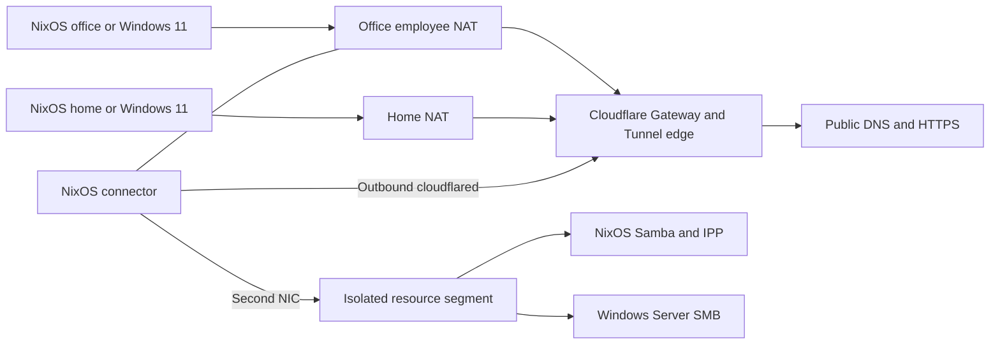

# Cloudflare Zero Trust SMB lab

A disposable, single-host KVM lab for a 50-person hybrid organization. Use one Cloudflare One Client per employee endpoint for public HTTPS inspection and private SMB and IPP. The same Gateway policy applies from office and home. NixOS provides two endpoints, a connector, Samba, and a CUPS IPP Everywhere test printer. Add a movable Windows 11 client and a Windows Server 2025 file server to the same lab.



| Segment | Addresses | Function |
| --- | --- | --- |
| Office employees | 192.168.246.0/24, gateway .1, office .10, connector .20 | Office and connector egress |
| Home | 192.168.247.0/24, gateway .1, remote .10 | Independent remote egress |
| Office resources | 192.168.250.0/24, connector .2, NixOS origin .10, Windows Server .30 | Unnumbered switch on the hypervisor |
| Windows 11 | DHCP .100–.199 on either NAT network | Move one enrolled client between sites |

Separate libvirt switches model office employee and resource VLAN broadcast domains without an 802.1Q trunk. The lightweight Linux connector replaces a firewall appliance. Its nftables rules drop employee-to-resource forwarding and permit resource-initiated DNS to the office gateway and public TCP 80/443 for updates. The origins accept service traffic only from the connector's resource IP. Resource SSH uses a jump through the connector and a lab-only key. Cloudflare Tunnel makes outbound connections and advertises each enabled origin as a /32. The home switch has no interface on the resource segment.

## Host setup

- Use x86-64 Linux with hardware KVM, system libvirt, QEMU, and dnsmasq. Expose nested virtualization on a VM host. Reserve 8 GiB RAM and approximately 35 GiB disk for the NixOS slice, including build cache. For both Windows guests aim for 20 GiB free RAM and 120 GiB additional storage capacity. The Windows disks are thin provisioned.
- On NixOS enable `virtualisation.libvirtd.enable` and add your operator to `libvirtd` and `kvm`. On Debian/Ubuntu install `qemu-system-x86 libvirt-daemon-system libvirt-clients dnsmasq-base` and add your operator to `libvirt` and `kvm`. Re-login, run `virsh -c qemu:///system list`, and verify `test -w /dev/kvm`. Windows also needs OVMF with Microsoft enrolled keys and `swtpm`.
- Run `nix --extra-experimental-features 'nix-command flakes' develop` for the pinned tools. Outside the dev shell use OpenTofu 1.10.6, Ansible Core, Just, Python 3, OpenSSH, `mkisofs` (or `genisoimage` with the alias), `xsltproc`, and ShellCheck. Building the pinned guest images still requires Nix on a non-NixOS host. The first build and provider initialization require network access for package caches and provider binaries. CI makes no Cloudflare requests and starts no VMs.

## Local bring-up

```sh
just check          # real provider schemas, mocked cloud plans, NixOS evaluation and lint
just plan           # build role images and print the local plan
just up             # review and type yes
just configure      # wait for cloud-init and provision the Samba login
just test           # encrypted SMB, actual IPP Print-Job, and no direct private path
just ssh origin 'sudo systemctl status lab-printer --no-pager'
```

[Local OpenTofu](iac/local/main.tf) manages libvirt. Cloud-init injects the SSH key created in `.lab/`. The inventory and SSH config are generated from [the address plan](topology.json), with an isolated trust-on-first-use host key file and ProxyJump to the origin. Compare initial fingerprints via the trusted console on a shared host. Ansible sets the disposable SMB account `labshare` from `.lab/smb-password`. This is separate from enrollment identity. Changing a role image or cloud-init seed replaces that VM. Keep any data you need outside the disposable guest disk. Tests write command results, network routes, transfer hashes and IPP job IDs under `.lab/proof/`. Treat logs and state as private.

## Dedicated Cloudflare setup

1. Create a new dedicated Cloudflare Zero Trust account and team. Use two real, controlled mailboxes in place of `employee@example.org` (allowed) and `visitor@example.org` (denied). Scope enrollment to those two users using an IdP or Cloudflare One-time PIN. In **Traffic policies > Traffic settings**, enable Secure Web Gateway TCP and UDP proxying, TLS decryption and activity logging. Record the prior settings and download the active Gateway root. These account-wide controls are manual so the IaC does not own or overwrite an account-wide settings resource.
2. Create a token scoped to the dedicated account with read/write permissions for Cloudflare Tunnel, Cloudflare One Networks, and Zero Trust settings and policy. Set the token from an external secret store. The wrapper binds the checkout and saved plan to the account ID. Never point it at a customer or production account.

   ```sh
   cp iac/cloud/lab.tfvars.example iac/cloud/lab.tfvars
   # Replace both example mailboxes in iac/cloud/lab.tfvars.
   export TF_VAR_account_id='<dedicated-lab-account-id>'
   export TF_VAR_dedicated_lab_account_confirmation="dedicated-lab:$TF_VAR_account_id"
   # Load CLOUDFLARE_API_TOKEN from your secret store.
   just cloud-plan
   # Review the account, rules and /32 routes in the plan.
   just cloud-apply
   ```

3. Retrieve the newly created `cfztna-lab` remotely managed Tunnel's connector secret in the dedicated dashboard. Set `CFZTNA_TUNNEL_TOKEN` from your secret store and run `just connector`. Verify `just ssh connector 'curl -fsS http://127.0.0.1:20241/ready'` and Tunnel health in the dashboard. Systemd passes the secret to cloudflared from a root-only credential file. The token is outside OpenTofu state.
4. Independently verify the downloaded CA fingerprint against the lab account, then run `just trust-ca /path/to/lab-gateway.pem`. That adds the root to the Linux CLI probe bundle. Configure other NixOS applications' trust independently, or add the verified root via `security.pki.certificateFiles` and rebuild the clients. For Windows use the guest's Local Computer trusted root store or Cloudflare's certificate deployment. Leave host trust untouched. TLS-pinned applications and private browser/runtime stores need individual evaluation.
5. On each Linux endpoint create the posture marker with `sudo install -m 0644 /dev/null /etc/cfztna-managed`. Enroll as the employee using `warp-cli --accept-tos registration new TEAM_NAME` and complete the browser flow. For a headless callback, use the documented CLI token method and handle the token as a secret. Run `warp-cli --accept-tos connect` and confirm the profile and identity. NixOS uses nixpkgs' community repackaging of the Cloudflare binary. Windows 11 provides the vendor-supported client path. [Manual enrollment](https://developers.cloudflare.com/cloudflare-one/team-and-resources/devices/cloudflare-one-client/deployment/manual-deployment/) · [Supported clients](https://developers.cloudflare.com/cloudflare-one/team-and-resources/devices/cloudflare-one-client/download/)

[Cloudflare IaC](iac/cloud/main.tf) pins the [official v5.24.0 provider](https://github.com/cloudflare/terraform-provider-cloudflare/tree/v5.24.0/docs/resources). It creates a scoped Traffic and DNS profile using MASQUE, lock, 30-second reconnect, and explicit exclusions. Management gateway /32s and link-local/broadcast/multicast are excluded. The resource /32s remain routed into WARP. Leave local network access and unrelated Local Domain Fallback disabled. The private default-deny applies to each lab origin. Its higher-priority exception requires the employee identity and a passing posture check for the approved TCP ports. The protected file is a test signal. Production should use a managed certificate or an MDM/compliance integration and IdP groups. HTTPS traffic is verified with a path-specific canary at `https://example.com/cfztna-lab-block`, a same-host control request, and the Gateway root. The DNS canary is `example.net`. Inspect the exact policy names in Gateway logs. [Private routing](https://developers.cloudflare.com/cloudflare-one/networks/connectors/cloudflare-tunnel/private-net/cloudflared/connect-cidr/) · [TLS decryption](https://developers.cloudflare.com/cloudflare-one/traffic-controls/http-policies/tls-decryption/)

### Fail-closed and bootstrap

The WARP switch lock and reconnect are user-level controls. After enrollment and WARP verification, enable the opt-in Linux egress firewall on each client.

```sh
just ssh office 'sudo install -d -m 0755 /etc/cfztna && sudo touch /etc/cfztna/egress-guard && sudo systemctl start lab-egress'
just ssh remote 'sudo install -d -m 0755 /etc/cfztna && sudo touch /etc/cfztna/egress-guard && sudo systemctl start lab-egress'
```

The guard permits loopback, the WARP adapter, management SSH replies and root-owned traffic to the documented WARP API and MASQUE transport endpoints. It blocks direct application DNS and HTTPS on the wired lab uplink. Enrollment and captive-portal sign-in precede guard activation. To complete future bootstrap without WARP, suspend it via management SSH, finish authentication, and immediately re-enable it. The captive portal timer doesn't override nftables. Production needs MDM enforcement, limited administrator access and an emergency workflow. Check your plan for specific device integrations, logging retention, DLP, and tamper protection. The Windows smoke path does not enforce an additional Windows kill switch. [Client firewall requirements](https://developers.cloudflare.com/cloudflare-one/team-and-resources/devices/cloudflare-one-client/deployment/firewall/)

### Live acceptance

```sh
CFZTNA_LIVE=1 just test-cloud allow
CFZTNA_LIVE=1 just test-cloud overlap
CFZTNA_LIVE=1 just test-cloud outage
CFZTNA_LIVE=1 just test-cloud fail-closed
CFZTNA_LIVE=1 just test-cloud deny-posture
CFZTNA_LIVE=1 just test-cloud deny-identity
```

Run the first four as the employee on both Linux clients with the marker present. Enable the egress guard before fail-closed. For deny-posture, remove the markers, retain the employee identity and wait for the posture failure to appear or the old result to expire. Restore the markers and verify allow again. For deny-identity, enroll both clients as the visitor with passing posture. A locked client may require an authorized override or revocation and fresh registration. Match the run's UTC timestamps to Gateway Network and HTTP logs for both users and both locations.

The overlap test adds a competing on-link resource /24 to the home client and checks that the WARP path continues to carry SMB. The connector outage stops only the tunnel and checks private failure with working public HTTPS. The fail-closed test stops WARP, tries direct public DNS and HTTPS using an independently resolved IP, verifies nftables drop counters and checks recovery. Live cases exit 77 until explicitly enabled. Local results establish service delivery and isolation before enrollment.

## Windows guests

Follow [the Windows VM and test runbook](windows/README.md) to attach Windows 11 and Windows Server 2025, configure the second encrypted SMB share, enroll the supported client, and move it between office and home. Enable the Windows /32 route in cloud variables after the server setup and firewall checks.

## Recovery and teardown

- VM boot or SSH failure. Use `virsh -c qemu:///system list --all`, the VM console, and its QEMU log. Check KVM permissions, disk format and ownership, and Windows ISO access. Verify a changed SSH host key on the console before updating the checkout's known-hosts entry.
- Tunnel or policy failure. Check the connector's `/ready` endpoint and `journalctl -u lab-tunnel`, WARP settings, the exact /32 routes, the deny/allow rule order, and posture freshness. Test direct origin service health from the connector before investigating Gateway.
- Guard blocks bootstrap. From management SSH run `sudo systemctl stop lab-egress; sudo rm -f /etc/cfztna/egress-guard`. Record `journalctl -u cloudflare-warp` and WARP status. Re-enable the guard after recovery. Use the VM console or rebuild the disposable VM if management routing changes.
- Destroy cloud before local. Revoke lab test registrations and stop `lab-tunnel`. With the same dedicated account variables and token, run `just cloud-destroy` and review the confirmation. Restore the manual lab dashboard settings and revoke the scoped API token. Remove the test CA from any client you keep. Shut down and remove Windows guests using `just windows-down client` and `just windows-down server`, then run `just down`. Keep state until destroy succeeds. Remove ignored secrets, proof logs and saved plans when finished. Nix garbage collection is optional and host-wide.

## Limits

The lab covers IPv4 policy and failure paths for representative endpoints. It cannot establish throughput or HA for 50 concurrent staff. WAN latency especially affects metadata-heavy SMB. Use workload and concurrency tests for sizing. Directed IPP avoids multicast discovery and retains the submitted document to prove delivery. Production printers need IPPS and managed discovery. The Windows server is a standalone file server. AD, Kerberos, private hostname routes, an internal cloud app and multiple connectors are outside this slice. Cloudflare's edge requires the real service and an enrolled lab account.
