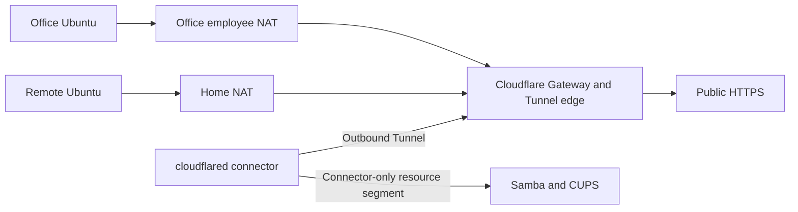

# Cloudflare Zero Trust SMB lab

A disposable, single-host KVM lab for validating inspected employee Internet access and private SMB and IPP access from office and remote Ubuntu laptops. The two clients use the same Cloudflare One Client profile. The resource segment uses an unnumbered libvirt bridge. Cloudflare Tunnel reaches it through a dual-homed connector and makes outbound connections to the Cloudflare edge.

The office employee and resource segments model two separate VLAN broadcast domains with distinct virtual switches. This lab uses IPv4, Ubuntu 24.04 x86-64 guests, and a Linux connector with nftables. The [address plan](topology.json) reserves a private /32 for the origin route and avoids registering either employee subnet in Cloudflare.

## Prerequisites and account boundary

Use an x86-64 Linux host with libvirt system access and readable and writable `/dev/kvm`. Nested virtualization is required on a VM host. Budget 8 GiB free RAM and 35 GiB free disk. Two clients model policy behavior for a 50-person organization.

Use a new Cloudflare Zero Trust lab account and independent test identities. Keep both Cloudflare API and connector tokens outside Git. The lab uses the real Cloudflare edge and requires network access. The local KVM and origin-service checks can run independently of Cloudflare.

The initial commit records the topology and account boundary. Provisioning, service setup, and verification are under development.
