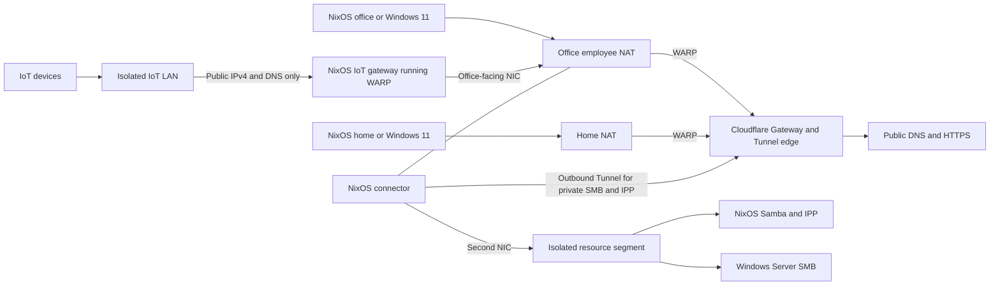

# Cloudflare Zero Trust SMB lab

A disposable, single-host KVM lab for a 50-person hybrid organization. Employee devices use Cloudflare One Client for public HTTPS inspection and private SMB and IPP from office and home. NixOS provides two workstations, a Tunnel connector, a Samba share, a CUPS IPP Everywhere test printer, and a gateway that gives clientless IoT devices inspected Internet access. The lab also supports a movable Windows 11 client and a Windows Server 2025 file server.



| Segment | Addresses | Function |
| --- | --- | --- |
| Office employees | 192.168.246.0/24, gateway .1, office .10, connector .20, IoT gateway uplink .30 | Office, connector, and IoT gateway egress |
| Home | 192.168.247.0/24, gateway .1, remote .10 | Independent remote egress |
| IoT LAN | 192.168.249.0/24, gateway and DNS .1, DHCP .100–.199 | Isolated switch with DHCP and WARP egress supplied by the IoT gateway |
| Office resources | 192.168.250.0/24, connector .2, NixOS origin .10, Windows Server .30 | Unnumbered switch on the hypervisor |
| Windows 11 | DHCP .100–.199 on either NAT network | Move one enrolled client between sites |

Separate libvirt switches model office employee and resource VLAN broadcast domains without an 802.1Q trunk. The lightweight Linux connector replaces a firewall appliance. Its nftables rules drop employee-to-resource forwarding and permit resource-initiated DNS to the office gateway and public TCP 80/443 for updates. The origins accept service traffic only from the connector's resource IP. Resource SSH uses a jump through the connector and a lab-only key. Cloudflare Tunnel makes outbound connections and advertises each enabled origin as a /32. The home switch has no interface on the resource segment.

The IoT gateway has one interface on the IoT switch and one on the office uplink. It forwards public traffic through its own WARP registration and blocks IoT devices from reaching office and private resource addresses. [IoT setup and tests](#iot-egress-through-cloudflare-gateway)

## Host setup

- Use x86-64 Linux with hardware KVM, system libvirt, QEMU, and dnsmasq. Expose nested virtualization on a VM host. Reserve 8 GiB RAM and approximately 35 GiB disk for the NixOS slice, including build cache. For both Windows guests aim for 20 GiB free RAM and 120 GiB additional storage capacity. The Windows disks are thin provisioned.
- On NixOS enable `virtualisation.libvirtd.enable` and add your operator to `libvirtd` and `kvm`. On Debian/Ubuntu install `qemu-system-x86 libvirt-daemon-system libvirt-clients dnsmasq-base` and add your operator to `libvirt` and `kvm`. Re-login, run `virsh -c qemu:///system list`, and verify `test -w /dev/kvm`. Windows also needs OVMF with Microsoft enrolled keys and `swtpm`.
- Run `nix --extra-experimental-features 'nix-command flakes' develop` for the pinned tools. Outside the dev shell use OpenTofu 1.10.6, Ansible Core, Just, Python 3, OpenSSH, `mkisofs` (or `genisoimage` with the alias), `xsltproc`, and ShellCheck. Building the pinned guest images still requires Nix on a non-NixOS host. The first build and provider initialization require network access for package caches and provider binaries. CI makes no Cloudflare requests and starts no VMs.

## Local bring-up

```sh
just check          # real provider schemas, mocked cloud plans, NixOS evaluation and lint
just plan           # build role images and print the local plan
just up             # review and type yes
just configure      # wait for cloud-init and provision the Samba login
just test           # encrypted SMB, actual IPP Print-Job, and no direct private path
just ssh origin 'sudo systemctl status lab-printer --no-pager'
```

For a handoff to a new host and account, start from a fresh clone. The bring-up commands generate local state and SSH credentials on that host. Run `just test` before enrolling WARP, then use the new lab account's credentials and CA for Cloudflare setup.

[Local OpenTofu](iac/local/main.tf) manages libvirt. Cloud-init injects the SSH key created in `.lab/`. The inventory and SSH config are generated from [the address plan](topology.json), with an isolated trust-on-first-use host key file and ProxyJump to the origin. Compare initial fingerprints via the trusted console on a shared host. Ansible sets the disposable SMB account `labshare` from `.lab/smb-password`. This is separate from enrollment identity. Changing a role image or cloud-init seed replaces that VM. Keep any data you need outside the disposable guest disk. Tests write command results, network routes, transfer hashes and IPP job IDs under `.lab/proof/`. Treat logs and state as private.

## Dedicated Cloudflare setup

1. Create a new dedicated Cloudflare Zero Trust account and team. Create one Cloudflare Access service token per WARP endpoint: office, remote, Windows 11 and IoT gateway. Add those tokens to the device enrollment policy with the Service Auth action. Keep the client IDs and secrets in an external secret store. [Service Auth enrollment](https://developers.cloudflare.com/cloudflare-one/team-and-resources/devices/cloudflare-one-client/deployment/device-enrollment/) In **Traffic policies > Traffic settings**, enable Secure Web Gateway TCP and UDP proxying, TLS decryption and activity logging. Record the prior settings and download the active Gateway root. These account-wide controls are manual so the IaC does not own or overwrite an account-wide settings resource.
2. Create a token scoped to the dedicated account with read/write permissions for Cloudflare Tunnel, Cloudflare One Networks, and Zero Trust settings and policy. Set the token from an external secret store. The wrapper binds the checkout and saved plan to the account ID. Never point it at a customer or production account.

   ```sh
   cp iac/cloud/lab.tfvars.example iac/cloud/lab.tfvars
   # Set team_name and enrollment_token_uuids in iac/cloud/lab.tfvars.
   # Use the Access token resource UUIDs. Keep the client secrets outside IaC.
   export TF_VAR_account_id='<dedicated-lab-account-id>'
   export TF_VAR_dedicated_lab_account_confirmation="dedicated-lab:$TF_VAR_account_id"
   # Load CLOUDFLARE_API_TOKEN from your secret store.
   just cloud-plan
   # Review the account, rules and /32 routes in the plan.
   just cloud-apply
   ```

   For a personal account explicitly approved for lab reuse, back up the existing Zero Trust settings and review any active users, routes, and policies before changing account-wide traffic settings. Use `approved-poc:$TF_VAR_account_id` for the confirmation on that account. Keep billing outside the lab setup.

3. Retrieve the newly created `cfztna-lab` remotely managed Tunnel's connector secret in the dedicated dashboard. Set `CFZTNA_TUNNEL_TOKEN` from your secret store and run `just connector`. Verify `just ssh connector 'curl -fsS http://127.0.0.1:20241/ready'` and Tunnel health in the dashboard. Systemd passes the secret to cloudflared from a root-only credential file. The token is outside OpenTofu state.
4. Independently verify the downloaded CA fingerprint against the lab account, then run `just trust-ca /path/to/lab-gateway.pem`. That adds the root to the Linux CLI probe bundle. Configure other NixOS applications' trust independently, or add the verified root via `security.pki.certificateFiles` and rebuild the clients. For Windows use the guest's Local Computer trusted root store or Cloudflare's certificate deployment. Leave host trust untouched. TLS-pinned applications and private browser/runtime stores need individual evaluation.
5. For each Linux endpoint, inject `CFZTNA_WARP_TEAM`, `CFZTNA_WARP_CLIENT_ID` and `CFZTNA_WARP_CLIENT_SECRET` from the secret store and run `just enroll-warp office`, `just enroll-warp remote` or `just enroll-warp iot-gateway` with that endpoint's token. The play installs the root-only managed profile and starts WARP. The workstation play also stages the lab posture marker. For Windows use [the Windows runbook](windows/README.md). Verify the registration and posture in Zero Trust. The devices use the shared `non_identity@<team>.cloudflareaccess.com` identity. [Headless deployment](https://developers.cloudflare.com/cloudflare-one/tutorials/deploy-client-headless-linux/)

[Cloudflare IaC](iac/cloud/main.tf) pins the [official v5.24.0 provider](https://github.com/cloudflare/terraform-provider-cloudflare/tree/v5.24.0/docs/resources). It creates a scoped Traffic and DNS profile using MASQUE, lock, 30-second reconnect, and explicit exclusions. Management gateway /32s and link-local/broadcast/multicast are excluded. The resource /32s remain routed into WARP. Leave local network access and unrelated Local Domain Fallback disabled. The private default-deny applies to each lab origin. Its higher-priority exception requires the shared service-registration identity and a passing posture check for the approved TCP ports. The protected file is a test signal. Production should use a managed certificate or an MDM/compliance integration and IdP groups. HTTPS traffic is verified with a path-specific canary at `https://example.com/cfztna-lab-block`, a same-host control request, and the Gateway root. The DNS canary is `example.net`. Inspect the exact policy names in Gateway logs. [Private routing](https://developers.cloudflare.com/cloudflare-one/networks/connectors/cloudflare-tunnel/private-net/cloudflared/connect-cidr/) · [TLS decryption](https://developers.cloudflare.com/cloudflare-one/traffic-controls/http-policies/tls-decryption/)

### Fail-closed and bootstrap

The WARP switch lock and reconnect are user-level controls. After enrollment and WARP verification, enable the opt-in Linux egress firewall on each client.

```sh
just ssh office 'sudo install -d -m 0755 /etc/cfztna && sudo touch /etc/cfztna/egress-guard && sudo systemctl start lab-egress'
just ssh remote 'sudo install -d -m 0755 /etc/cfztna && sudo touch /etc/cfztna/egress-guard && sudo systemctl start lab-egress'
```

The guard permits loopback, the WARP adapter, management SSH replies and root-owned traffic to the documented WARP API and MASQUE transport endpoints. It blocks direct application DNS and HTTPS on the wired lab uplink. Enrollment and captive-portal sign-in precede guard activation. To complete future bootstrap without WARP, suspend it via management SSH, finish authentication, and immediately re-enable it. The captive portal timer doesn't override nftables. Production needs MDM enforcement, limited administrator access and an emergency workflow. Check your plan for specific device integrations, logging retention, DLP, and tamper protection. The Windows smoke path does not enforce an additional Windows kill switch. [Client firewall requirements](https://developers.cloudflare.com/cloudflare-one/team-and-resources/devices/cloudflare-one-client/deployment/firewall/)

### Live acceptance

```sh
CFZTNA_LIVE=1 just test-cloud allow
CFZTNA_LIVE=1 just test-cloud overlap
CFZTNA_LIVE=1 just test-cloud outage
CFZTNA_LIVE=1 just test-cloud fail-closed
CFZTNA_LIVE=1 just test-cloud deny-posture
```

Run the first four with the managed marker present on both Linux workstations. Enable the egress guard before fail-closed. For deny-posture, remove the markers and wait for the posture failure to appear or the old result to expire. Restore the markers and verify allow again. Match the run's UTC timestamps and device identifiers to Gateway Network and HTTP logs for both locations.

The overlap test adds a competing on-link resource /24 to the home client and checks that the WARP path continues to carry SMB. The connector outage stops only the tunnel and checks private failure with working public HTTPS. The fail-closed test stops WARP, tries direct public DNS and HTTPS using an independently resolved IP, verifies nftables drop counters and checks recovery. Live cases exit 77 until explicitly enabled. Local results establish service delivery and isolation before enrollment.

`just test-cloud` runs the Linux workstation checks. Use the [Windows runbook](windows/README.md) and the [IoT checks below](#iot-egress-through-cloudflare-gateway) to verify those paths on each new deployment.

## Windows guests

Follow [the Windows VM and test runbook](windows/README.md) to attach Windows 11 and Windows Server 2025, configure the second encrypted SMB share, enroll the client, and move it between office and home. Enable the Windows /32 route in cloud variables after the server setup and firewall checks. Live lab verification covered inspected HTTPS and encrypted read/write against both shares from the same Windows 11 registration on both networks. The home client also submitted a native IPP job that CUPS stored as a PDF.

## Recovery and teardown

- VM boot or SSH failure. Use `virsh -c qemu:///system list --all`, the VM console, and its QEMU log. Check KVM permissions, disk format and ownership, and Windows ISO access. Verify a changed SSH host key on the console before updating the checkout's known-hosts entry.
- Tunnel or policy failure. Check the connector's `/ready` endpoint and `journalctl -u lab-tunnel`, WARP settings, the exact /32 routes, the deny/allow rule order, and posture freshness. Test direct origin service health from the connector before investigating Gateway.
- Guard blocks bootstrap. From management SSH run `sudo systemctl stop lab-egress; sudo rm -f /etc/cfztna/egress-guard`. Record `journalctl -u cloudflare-warp` and WARP status. Re-enable the guard after recovery. Use the VM console or rebuild the disposable VM if management routing changes.
- Destroy cloud before local. Revoke lab test registrations and stop `lab-tunnel`. With the same account variables and token, run `just cloud-destroy` and review the confirmation. Remove the lab's Service Auth rule from device enrollment and revoke its service tokens. Restore the account-wide Gateway proxy, logging, TLS, and certificate settings you recorded during setup. Remove the lab CA from any client you keep and revoke the scoped API token. Shut down and remove Windows guests using `just windows-down client` and `just windows-down server`, then run `just down`. Keep state until destroy succeeds. Remove ignored secrets, proof logs and saved plans when finished. Nix garbage collection is optional and host-wide.

## Limits

The lab covers IPv4 policy and failure paths for representative endpoints. It cannot establish throughput or HA for 50 concurrent staff. WAN latency especially affects metadata-heavy SMB. Use workload and concurrency tests for sizing. Directed IPP avoids multicast discovery and retains the submitted document to prove delivery. Production printers need IPPS and managed discovery. The Windows server is a standalone file server. AD, Kerberos, private hostname routes, an internal cloud app and multiple connectors are outside this slice. Cloudflare's edge requires the real service and an enrolled lab account.

## IoT egress through Cloudflare Gateway

The NixOS `iot-gateway` VM is a transparent IPv4 router for clientless lab devices. One enrolled Cloudflare One Client in Traffic and DNS mode supplies the tunnel and DNS proxy. Live lab checks verified DNS resolution, the inspected HTTPS canary, and blocked access to private addresses from an IoT-only client. Repeat the checks on the recipient's account and client version. [Cloudflare One Client traffic routing](https://developers.cloudflare.com/cloudflare-one/team-and-resources/devices/cloudflare-one-client/configure/route-traffic/client-architecture/)

- **IoT LAN:** Attach client NICs only to the isolated `cfztna-iot` libvirt network. The gateway supplies DHCP leases at `192.168.249.100–199`, router and DNS at `192.168.249.1`, and MTU 1280. A client with a static address needs the same gateway, DNS server and MTU.
- **Uplink:** The gateway uses `192.168.246.30` on the office NAT for enrollment and WARP transport. On this host use `just ssh iot-gateway` for administration. IoT endpoints never join the office NAT.
- **Enforcement:** An IoT-only routing table has an unreachable default until the WARP interface appears. The firewall forwards public IPv4 only via WARP, masquerades IoT addresses there and permits established tunnel replies. It blocks private destinations and alternate classic DNS/DoT, and offers DHCP and DNS only on the lab LAN. DNS has no fallback upstream beyond the WARP local proxy. HTTPS-based DNS still needs a Gateway policy if applicable. Internet-bound IPv6 forwarding is disabled. Devices on the same IoT segment can communicate directly unless separately isolated.
- **Identity:** Cloudflare sees the enrolled gateway's identity after NAT. Enroll it with its own service token and leave the workstation posture marker absent so it cannot qualify for the private-origin allow rule. One gateway policy does not provide independent device identity or posture. The IoT subnet is a local exclusion in the dedicated cloud profile. Keep public egress tunneled; disable Local Domain Fallback for any names that must go to Gateway. TLS inspection requires CA trust on the IoT device. Certificate-pinned devices generally require explicit decryption exceptions.

Use `just up` to bring up the IoT gateway. Apply the scoped Cloudflare profile in your dedicated account, then inject the gateway's service-token credentials and run `just enroll-warp iot-gateway`. Check `warp-cli settings`, `ip -4 route show table 149`, and `sudo nft list table inet iot_gateway` on the node. Table 149 should show both the WARP default and the unreachable fallback.

From an IoT-only guest check a DHCP lease, run `dig @192.168.249.1 example.com`, and make an HTTPS request. Verify the DNS and HTTPS activity in Gateway under the gateway identity. If TLS decryption is enabled, use a verified Gateway CA on the test device and test the existing same-host HTTPS path canary. Stop `cloudflare-warp` on the gateway and retry DNS and a direct-IP HTTPS request to confirm failure. Restart it and confirm recovery. Check that `192.168.246.1`, SMB and IPP resource addresses remain unreachable from the IoT client throughout.

For the disconnected smoke test on the lab host, run `sudo tests/iot-local.sh` with BusyBox, netcat and dig installed while the gateway is unenrolled or WARP is stopped. It creates a temporary network namespace on the lab IoT bridge, checks DHCP and verifies that public, office and resource traffic cannot escape without WARP. Restart the gateway's WARP service after the test if you stopped it.

For physical devices, connect their dedicated VLAN or access ports to the gateway's IoT-side bridge via a dedicated NIC or VLAN subinterface. Keep that L2 network separate from the office uplink and remove any other gateway, DHCP server or IPv6 router advertisements on it before onboarding devices. The default deployment connects only the virtual IoT switch.
